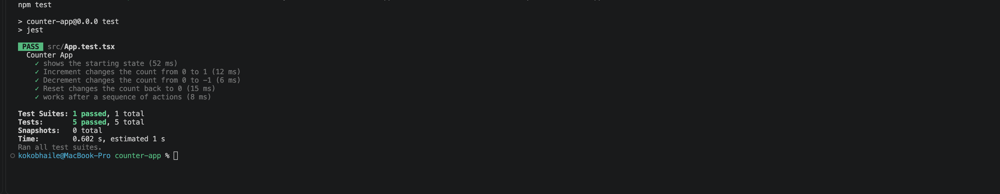
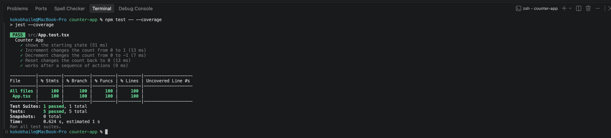

# Lab: Exploratory and White Box Testing

This is a small counter app. First I used the app and wrote down what I tried. After that I looked at the code and wrote tests.

## How to run

```bash
npm install
npm run dev
```

To run the tests:

```bash
npm test
```

To see coverage:

```bash
npm test -- --coverage
```

## Step 1: Exploratory Testing

Testing charter: I want to see how Increment, Decrement, and Reset change the count, including when I start at 0 and when I click more than one button.

I ran the app in the browser first. I did not look at the source code yet.

| Action | Expected Result | Actual Result | Pass or Fail |
| --- | --- | --- | --- |
| Open the app | The page shows Count: 0 and the Increment, Decrement, and Reset buttons | The heading was Count: 0. I saw Increment, Decrement, and Reset | Pass |
| Select Increment once | The count increases by one | Count: 1 | Pass |
| Select Increment again | The count increases by one more | Count: 2 | Pass |
| Select Decrement once | The count decreases by one | Count: 1 | Pass |
| Select Reset | The count goes back to 0 | Count: 0 | Pass |
| Select Decrement when the count is already 0 | I thought the count might stay at 0 | Count: -1 | Fail |
| Select Increment three times after the count was -1, then select Reset | The count goes to 0, then 1, then 2, then back to 0 | The headings were Count: 0, then Count: 1, then Count: 2, then Count: 0 | Pass |
| Select Reset when the count is already 0 | The count stays at 0 | Count: 0 | Pass |

## Step 2: Examine the Source Code

I looked at `src/App.tsx` after I was done clicking around.

The starting value of `count` is `0`. It uses `useState(0)`.

These lines change the count:

- `setCount(count + 1)` when I click Increment
- `setCount(count - 1)` when I click Decrement
- `setCount(0)` when I click Reset

I did not find any branches. There is no if statement.
I also did not find any loops.

Branch coverage does not really apply here because there is nothing to branch on. Loop coverage does not apply either. Jest still printed 100% for branches. I think that is because there were no extra paths to miss.

## Steps 3 to 6: The tests I wrote

I added `src/App.test.tsx`. The tests use React Testing Library. I used `render`, `screen`, and `fireEvent`. I used `expect` to check the count.

The tests are in a `describe` block called Counter App.

- One test checks that it starts at `Count: 0` and that the three buttons are there.
- One test clicks Increment and checks 0 to 1.
- One test clicks Decrement and checks 0 to -1.
- One test clicks Increment twice (the count is 2) and then Reset, and checks it goes back to 0.
- One more test does a sequence: Increment three times (3), Decrement (2), Reset (0), then Decrement again (-1).

## Step 7: Run the Tests

I ran:

```bash
npm test
```

5 tests passed.



## Step 8: Review Code Coverage

I ran:

```bash
npm test -- --coverage
```

Coverage reported for `App.tsx`:

| Coverage Type | Percentage |
| ------------- | ---------- |
| Statements    | 100%       |
| Branches      | 100%       |
| Functions     | 100%       |
| Lines         | 100%       |



The tests ran the first render and the Increment, Decrement, and Reset lines. I do not think any statement in `App.tsx` was skipped.

The report says 100% branches even though there is no if in the file. That is because there were no branch paths to miss.

I do not think a high percentage by itself proves the app is correct. It only shows that my tests ran those lines. For example the count can go below 0, and coverage would still look fine.

## Step 9: Compare the Two Approaches

When I was just clicking around, I found that Decrement from 0 goes to -1. I thought it might stay at 0.

When I read the code, I saw each button has its own `setCount` line, so I wrote a test for each one. The Reset test has to change the count first. If I reset when it is already 0, I cannot tell that Reset did anything.

Looking at the code changed how I tested. I stopped only clicking around and wrote tests for each line that changes the count.

Exploratory testing can miss things I do not think to try. I also cannot see why something happened.

White box testing can make me only test what the code already does. 100% coverage can still miss something the app should do, like stopping at 0.

## AI Transparency

AI was used to create part of this file and to clean up its writing and formatting.
